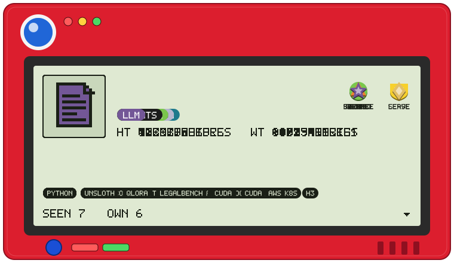
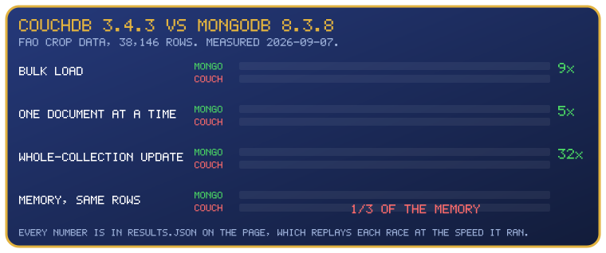

<h1 align="center">Kharanshu Naghera</h1>

Machine learning engineer, Toronto. Risk and fraud models at RBC. The eight badges on the card are measured results; the index below has one entry per project and shows the badge it earned.

  

The ID number is the GitHub user id of this account (57245614); the start date is when the account was opened.

<h2 align="center">Projects</h2>

  

- 001 [Social-Distance-Analyzer](https://github.com/combax/Social-Distance-Analyzer), Ground badge.
  Pair F1 0.99 at 2 m against 0.50 for the pixel rule; 11 YOLO detectors benchmarked.
- 002 [regcite](https://github.com/combax/regcite), Cite badge. RP2040 parsed 949/949 registers
  against the vendor's SVD; Qwen2.5-7B goes from 2/30 to 29/30 questions with the lookup tools.
- 003 [eBay-iPhone-Price-Prediction](https://github.com/combax/eBay-iPhone-Price-Prediction), Sold
  and Serve badges. MAE C$62, R² 0.94 on 30k sold listings; a Go + ONNX server that exits when its
  output drifts from the Python model.
- 004 [From-Data-to-Justice](https://github.com/combax/From-Data-to-Justice), Balance badge.
  Held-out macro-F1 0.635 against 0.469 for always Male, on 573k solved homicides.
- 005 Agent coordination for Claude Code, not yet public, Brief and Lease badges. Written briefs
  landed 20 of 20 runs clean against 2 of 3 slices for the vague prompt; one GPU job at a time gave
  0 overlaps against 3.
- 006 [Fine-tuning-and-Benchmarking-legal-LLMs](https://github.com/combax/Fine-tuning-and-Benchmarking-legal-LLMs),
  Legal badge. Qwen2.5-3B with 4-bit QLoRA beats the base model on 10 of 15 LegalBench tasks and
  full LoRA on 11.

<h2 align="center">Experience</h2>

  <picture>
    <source media="(prefers-color-scheme: dark)" srcset="assets/rows/rbc-dark.svg">
    
  </picture>
  <picture>
    <source media="(prefers-color-scheme: dark)" srcset="assets/rows/apex-dark.svg">
    
  </picture>

<h2 align="center">Education</h2>

  <picture>
    <source media="(prefers-color-scheme: dark)" srcset="assets/rows/trent-dark.svg">
    
  </picture>
  <picture>
    <source media="(prefers-color-scheme: dark)" srcset="assets/rows/gtu-dark.svg">
    
  </picture>

<h2 align="center">CouchDB vs MongoDB</h2>

  

The page replays each of the six experiments at the speed it ran, with a continent picker and the raw numbers: <a href="https://couch-vs-mongo.realknaghera1.workers.dev/">couch-vs-mongo.realknaghera1.workers.dev</a>.

<h2 align="center">Older repos</h2>

<a href="https://github.com/combax/Global-Power-Plant-Database-Analysis">Global-Power-Plant-Database-Analysis</a> (SQL, Power BI), <a href="https://github.com/combax/Domestic-Violence-EDA">Domestic-Violence-EDA</a> (Python), <a href="https://github.com/combax/EDA-of-US-baby-names">EDA-of-US-baby-names</a> (MongoDB, Python).

<h2 align="center">Contact</h2>

<a href="mailto:realknaghera1@gmail.com">realknaghera1@gmail.com</a> and <a href="https://www.linkedin.com/in/knaghera">linkedin.com/in/knaghera</a>.

